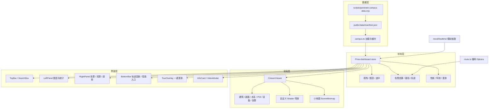

# 云屿园区数字孪生运营平台

面向园区运营演示的 Cesium 单引擎数字孪生大屏。基于 Vue 3 + TypeScript + Vite，全部数据为本地确定性生成的演示数据，不依赖真实 IoT、视频流或后端服务。

## 快速开始

```bash
npm install
npm run dev          # 本地预览 http://127.0.0.1:5174
npm run type-check   # vue-tsc 类型检查
npm run build:data   # 重新生成园区与业务演示数据
```

> 仅支持 PC 本地运行：不做移动端适配（移动端只显示提示页）；不做构建产物交付与部署。

## 功能范围

| 编号 | 功能 | 状态 |
| --- | --- | --- |
| F1 | 三维场景底座（建筑白模 / 道路 / 水系 / POI / 周边楼宇） | 已完成 |
| F2 | 片区 → 园区 → 楼栋三级视角 | 已完成 |
| F3 | 图层管理（底图 / 白模 / 周边 / 设备 / 告警 / POI） | 已完成 |
| F4 | 建筑与设备拾取、信息卡、实时曲线 | 已完成 |
| F5 | 告警定位、楼体变色、脉冲、五步处置闭环 | 已完成 |
| F6 | 处置资源、路网路径规划、行进动画 | 已完成 |
| F7 | 轨迹回放（6 条共 1200 点） | 已完成 |
| F8 | 2D 小地图与 3D 主场景联动 | 已完成 |
| F9 | 告警趋势图表筛选与场景高亮联动 | 已完成 |
| F10 | 1920 设计稿适配 2K / 4K（按缩放比提升渲染分辨率） | 已完成 |
| F11 | 模拟实时推送（5s）与断线重连 | 已完成 |
| F12 | 一键自动漫游（7 段、约 3 分钟） | 已完成 |
| F13 | 自定义 Shader：边界流光、地面扫描环、告警热力 | 已完成 |
| F14 | 性能面板（FPS / Draw Call / 图元 / 内存 / 画质档位） | 已完成 |
| F15 | 楼层抽离查看内部结构 | 已完成 |
| F16 | 视频点位与模拟视频窗 | 已完成 |
| F17 | 楼栋 / 设备搜索定位 | 已完成 |

## 架构



## 目录结构

```
├── public/data/              # 园区 GeoJSON 与业务 JSON（manifest + campus/ + business/）
├── scripts/                  # 确定性数据生成脚本
├── docs/                     # 设计方案、数据说明
└── src/
    ├── components/
    │   ├── charts/           # ECharts 趋势图
    │   ├── common/           # 移动端提示页
    │   ├── layout/           # 顶栏、左右面板、底栏、搜索、漫游浮层
    │   └── scene/            # Cesium 场景、信息卡、处置时间线、视频窗、性能面板、小地图
    ├── composables/          # 大屏缩放、移动端识别
    ├── data/                 # 数据加载与缓存
    ├── services/             # 路网寻路、模拟实时链路
    ├── stores/               # Pinia 业务状态
    ├── types/                # 领域类型
    ├── utils/                # 时间等工具
    └── views/                # 大屏页面
```

## 交互说明

| 操作 | 效果 |
| --- | --- |
| 点击建筑 / 设备 / 告警点 | 选中并弹出信息卡，相机下钻 |
| 点击右侧告警项 | 相机飞向告警楼栋并进入处置流程 |
| 点击「自动演示」 | 自动演完接警 → 确认 → 派发 → 到场 → 处理 → 归档 |
| 点击处置资源 | 规划路网路径并播放车辆行进 |
| 拖动底部时间轴 | 回放人员 / 车辆轨迹 |
| 点击趋势图档位 | 筛选对应小时告警并在场景高亮 |
| 点击顶部「漫游」或按 `R` | 启动 / 停止一键漫游 |
| 按 `/` | 聚焦搜索框，输入楼栋或设备名定位 |
| 点击 `CAM` 点位 | 打开模拟视频窗 |
| 点击底部「性能监视」 | 查看 FPS / Draw Call / 图元 / 内存并切换画质档位 |

## 数据规模

- 园区建筑 128 栋（12 栋重点）、周边楼宇 115 栋、道路 / 水系 / POI / 资源若干
- 设备 90 个、告警 28 条、轨迹 6 条共 1200 点
- 数据由 `scripts/generate-campus-data.mjs` 使用固定随机种子生成，可重复复现

字段与 3D Tiles 降级策略见 [docs/数据说明.md](docs/数据说明.md)。

## 性能与限制

- 1080p 实测：60 FPS，Draw Call 93–99，图元约 420–440（性能面板可复现）
- 周边楼宇已合批为单个 Primitive；画质档位可调分辨率缩放、MSAA 与周边楼宇显隐
- 未做：真实 IoT / 视频流接入、后端与权限、移动端布局、Three.js 双引擎、部署与构建产物
